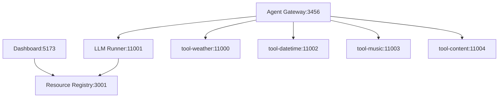

# Co-Agent 项目配置管理指南

## 概述

本项目提供了统一的配置管理系统，用于管理所有服务的端口、连接和启动命令。不再需要手动修改各个服务的配置文件。

## 项目架构

```
Co-Agent 项目结构:
├── Agent Gateway (Rust) - 端口 3456 - API网关
├── LLM Runner (Python) - 端口 11001 - LLM处理服务  
├── Resource Registry (Node.js) - 端口 3001 - 资源注册中心
├── Dashboard (React) - 端口 5173 - 前端界面
└── 工具服务 (Python):
    ├── tool-weather - 端口 11000 - 天气服务
    ├── tool-datetime - 端口 11002 - 日期时间服务
    ├── tool-music - 端口 11003 - 音乐服务
    └── tool-content - 端口 11004 - 内容服务
```

## 服务连接关系



## 配置文件结构

### 主配置文件
- `config/services.yaml` - 所有服务的统一配置

### 自动生成的配置文件
- `app/agent-gateway/src/services.rs` - Rust服务连接配置
- `app/dashboard/src/utils/api.ts` - 前端API配置
- `app/dashboard/vite.config.ts` - Vite代理配置
- `app/llm-runner/.env` - LLM Runner环境变量
- `.env.development` / `.env.production` - 环境配置

## 快速开始

### 方法一：Windows 批处理脚本（最简单）

```cmd
# 双击运行或在命令行执行
start.bat
```

### 方法二：PowerShell 脚本（推荐，Windows）

```powershell
# 在PowerShell中运行
.\start.ps1
```

### 方法三：Python 启动脚本（跨平台）

```bash
# 改进版启动脚本
python start_simple.py

# 或原版脚本
python start.py
```

### 方法四：使用 Makefile (Linux/Mac)

```bash
# 查看所有可用命令
make help

# 安装依赖
make install

# 启动开发环境
make dev

# 启动生产环境  
make prod

# 停止所有服务
make stop
```

### 方法五：使用服务管理器（高级用户）

```bash
# 启动所有服务
python scripts/service_manager.py start

# 启动指定服务
python scripts/service_manager.py start --service agent-gateway

# 查看服务状态
python scripts/service_manager.py list

# 停止所有服务
python scripts/service_manager.py stop
```

## 配置管理

### 更新配置文件

```bash
# 为开发环境更新配置
python scripts/config_generator.py --env development

# 为生产环境更新配置  
python scripts/config_generator.py --env production
```

### 修改端口和连接

1. 编辑 `config/services.yaml`
2. 修改相应服务的端口或连接地址
3. 运行配置生成器更新所有相关文件
4. 重启服务

例如，修改 Agent Gateway 端口：

```yaml
services:
  agent-gateway:
    port: 8080  # 从 3456 改为 8080
```

然后运行：
```bash
python scripts/config_generator.py --env development
make restart
```

## 环境配置

### 开发环境 (development)
- Host: `localhost`
- 所有服务在本地运行
- 使用开发模式启动命令

### 生产环境 (production)  
- Host: `0.0.0.0`
- 使用生产模式启动命令
- 自动生成 Docker 和 Kubernetes 配置

## 部署方式

### Docker 部署

```bash
# 生成 Docker Compose 配置
make config-prod

# 启动 Docker 服务
make docker
```

### Kubernetes 部署

```bash
# 生成 K8s 配置文件
make config-prod

# 部署到 Kubernetes
kubectl apply -f deploy/kubernetes/generated/
```

## 服务启动顺序

系统会按以下顺序启动服务：

1. **Resource Registry** - 资源注册中心
2. **工具服务** - 所有工具服务并行启动
3. **LLM Runner** - LLM处理服务
4. **Agent Gateway** - API网关
5. **Dashboard** - 前端界面

## 健康检查

所有服务都提供健康检查端点：

- Agent Gateway: `http://localhost:3456/health`
- LLM Runner: `http://localhost:11001/health`  
- Resource Registry: `http://localhost:3001/health`
- 工具服务: `http://localhost:1100X/health`

## 常见问题

### Q: 如何添加新的工具服务？

A: 编辑 `config/services.yaml`，在 `tools` section 添加新服务：

```yaml
tools:
  tool-newservice:
    name: "New Service"
    language: "python"
    port: 11005
    path: "co-agent/tools/tool-newservice"
    startup:
      development: "python main.py"
      production: "uvicorn main:app --host 0.0.0.0 --port 11005"
```

然后更新 Agent Gateway 的连接配置。

### Q: 如何更改所有服务的host地址？

A: 修改 `config/services.yaml` 中的环境配置：

```yaml
env:
  production:
    host: "your-server-ip"  # 修改为实际服务器IP
```

### Q: 服务启动失败怎么办？

A: 
1. 检查端口是否被占用
2. 查看依赖服务是否正常启动
3. 检查配置文件是否正确生成
4. 查看具体的错误日志

### Q: 如何在生产环境中使用？

A:
1. `make config-prod` - 生成生产配置
2. `make build` - 构建所有项目
3. `make prod` - 启动生产环境

## 项目管理命令总结

```bash
# 开发
make install        # 安装依赖
make dev           # 启动开发环境
make dev-fast      # 快速启动（简化版）

# 配置
make config-dev    # 生成开发配置
make config-prod   # 生成生产配置

# 部署
make prod          # 启动生产环境
make docker        # Docker部署

# 维护
make stop          # 停止服务
make restart       # 重启服务
make status        # 查看状态
make clean         # 清理文件
```

