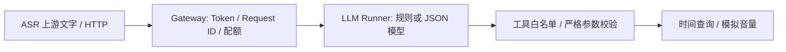

# Voice Agent Runtime · 智能音箱指令后端演示

一条可以离线运行和测试的 **Gateway → LLM Runner → Tool Registry** 链路，聚焦鉴权、并发保护、超时回收和工具调用边界。

**Python · FastAPI · asyncio · Pydantic · OpenAI-compatible API**

[](https://github.com/casset23/voice-agent-runtime/actions/workflows/ci.yml)

> 这是 2026-10-24 为个人作品集独立实现的演示版，使用 AI 辅助编码并补充自动化测试。没有复制公司项目源码、配置和数据，不代表既有实习项目的完整系统。当前输入为文字，语音采集和真实音箱驱动待接入。

## 为什么做

模型调用之外还需要回答后端问题：入口是否真的验证凭据，请求高峰是否拖垮服务，模型是否返回未授权工具，超时后是否回收配额。这个演示用一条最小链路让这些行为能够直接测试。



组件采用同一进程中的逻辑分层，便于复现。默认规则模式不调用 LLM；OpenAI 模式请求配置的兼容模型接口。

## 运行

Python 3.11+：

```bash
python -m venv .venv
# Windows: .venv\Scripts\activate
# macOS/Linux: source .venv/bin/activate
python -m pip install -r requirements-dev.txt
```

PowerShell：

```powershell
$env:AGENT_API_TOKEN = python -c "import secrets; print(secrets.token_urlsafe(32))"
python -m uvicorn runtime.api:create_app --factory --host 127.0.0.1 --port 8000
```

在另一终端使用同一个 Token。打开 `/docs` 可通过 Authorize 输入它。跨平台 curl 示例：

```bash
curl http://127.0.0.1:8000/v1/commands \
  -H "Authorization: Bearer YOUR_LOCAL_TOKEN" \
  -H "Content-Type: application/json" \
  -d '{"text":"现在几点"}'
```

也支持 `{"text":"音量30"}`。音量工具返回 `{"level":30,"simulated":true}`，不操作真实设备。离线规则只识别这两类指令。

## 真实模型

设置 `AGENT_MODEL_MODE=openai`、`LLM_API_KEY`、`LLM_BASE_URL`（以 `/v1` 结尾）和 `LLM_MODEL`，然后重启。`.env.example` 是变量清单，默认不自动读取 `.env`。兼容服务需要支持 `response_format=json_object`。

真实模型联网与效果未在本次发布中验证；测试注入确定性规划器，不消耗外部 Token。模型结果始终经过白名单和参数校验。

## 可检查的行为

| 场景 | 结果 |
| --- | --- |
| 未配置入口 Token | 启动失败 |
| 错误或缺失 Token | `401` |
| 空指令 / 超过 2000 字符 | `422` |
| 达到并发上限 | 有限等待后 `429`，附 `Retry-After` |
| 模型超时 | `504`，回收配额 |
| 未知工具、额外参数或越界音量 | `502`，拒绝执行 |
| 正常请求 | 工具结果与 `X-Request-ID` |

默认容量 8、规划超时 20 秒，可通过 `create_app(capacity=..., timeout=...)` 调整。容量属于单个应用进程，多 worker 不共享配额，不等同于分布式限流或压测结论。

`GET /health` 无需鉴权；`GET /v1/resources` 和 `POST /v1/commands` 需要 Bearer Token。资源接口返回工具 JSON Schema。

## 测试与阅读顺序

```bash
python -m pytest -q
```

测试覆盖正常调用、真实 Token 比较、输入边界、工具白名单、严格整数、无效时区、超时后恢复与并发饱和后恢复。

1. `runtime/api.py`：入口治理、Schema、工具执行。
2. `runtime/models.py`：规则规划器与模型适配。
3. `tests/test_api.py`：接口与错误边界。
4. `docs/design.md`：设计选择与公开范围。

后续方向：接入 ASR/TTS 和真实设备，补充模型契约测试；存在明确跨进程需求后再拆服务。当前没有音乐服务、硬件驱动、多轮自主规划或线上性能数字。
